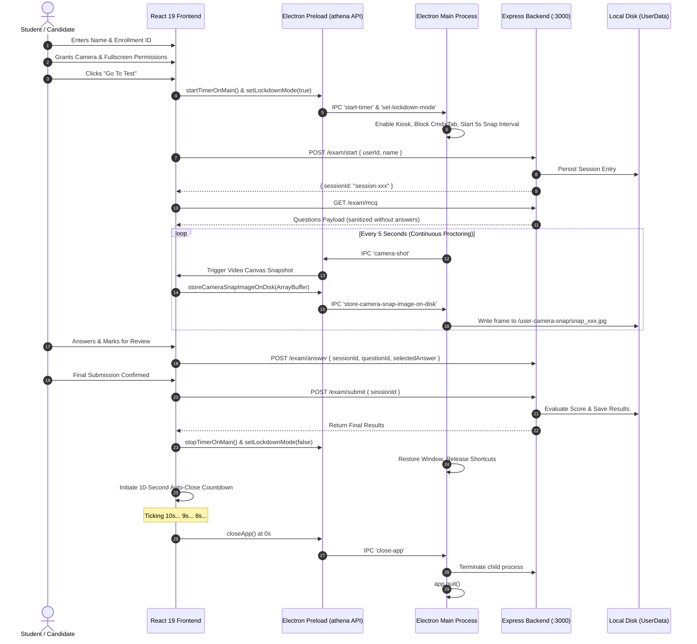

# Athena Exam Proctor 🛡️

[](https://www.electronjs.org/)
[](https://react.dev/)
[](https://vite.dev/)
[](https://expressjs.com/)
[-000000?logo=apple&logoColor=white)](https://apple.com)
[](#)

**Athena** is an enterprise-grade, high-integrity desktop examination and proctoring platform engineered for secure remote assessments. Built on **Electron**, **React 19**, and an embedded **Express.js** backend, Athena enforces strict operating-system kiosk lockdown, continuous automated webcam telemetry verification, dynamic student authentication, question review management, and automated post-exam session termination.

---

## Table of Contents

- [1. System Architecture & Structural Design](#1-system-architecture--structural-design)
  - [High-Level Architecture Diagram](#high-level-architecture-diagram)
  - [Process Interaction & Data Flow](#process-interaction--data-flow)
- [2. Key Features & Capabilities](#2-key-features--capabilities)
- [3. Security & Lockdown Engine](#3-security--lockdown-engine)
- [4. REST API Specifications](#4-rest-api-specifications)
- [5. Project Directory Structure](#5-project-directory-structure)
- [6. Getting Started](#6-getting-started)
  - [Prerequisites](#prerequisites)
  - [Installation](#installation)
  - [Running in Development](#running-in-development)
  - [Packaging the macOS DMG](#packaging-the-macos-dmg)
- [7. Verification & Quality Assurance](#7-verification--quality-assurance)

---

## 1. System Architecture & Structural Design

Athena employs a multi-process architecture with strict process isolation, context bridging, and headless background service virtualization.

### High-Level Architecture Diagram

```mermaid
graph TD
    subgraph Host["macOS Operating System Environment"]
        Kiosk["macOS Kiosk Mode & Spaces Lock"]
        Shortcuts["System Shortcut Interceptor (Cmd+Tab, Cmd+Q, Alt+Tab)"]
        CameraHardware["Hardware Webcam / AVCaptureSession"]
        DiskStorage["Local Disk Storage (app.getPath('userData'))"]
    end

    subgraph ElectronMain["Electron Main Process (Node.js Environment)"]
        App["App Lifecycle Controller (app/app.js)"]
        SingleInstance["Single Instance Mutex Lock"]
        TimerService["Main High-Precision Stopwatch Engine"]
        SnapScheduler["5-Second Camera Snapshot Interval"]
        LockdownEngine["Window Stacking (screen-saver level) & Blur Guard"]
        ProcessManager["Headless Background Process Manager"]
    end

    subgraph IPCBridge["Secure Context Bridge (app/preload.js)"]
        ContextBridge["contextBridge.exposeInMainWorld('athena')"]
        IPCHandlers["IPC Renderer ↔ Main Channels"]
    end

    subgraph RendererProcess["Renderer Process (React 19 + Vite UI)"]
        SetupView["View 1: Verification & Dynamic Candidate Auth"]
        ExamView["View 2: Active Exam, PiP Webcam & Question Palette"]
        ResultsView["View 3: Score Breakdown & 10s Auto-Close Countdown"]
        ReviewState["Mark for Review State Engine"]
    end

    subgraph BackendProcess["Headless Express Backend Service (Node.js)"]
        ExpressApp["Express.js Server (backend/server.js :3000)"]
        ExamRouter["Exam Session Controller"]
        JSONStore["JSON File Database (questions.json & sessions.json)"]
    end

    %% Interactions
    App --> SingleInstance
    App --> LockdownEngine
    LockdownEngine -.-> Kiosk
    LockdownEngine -.-> Shortcuts
    ProcessManager -->|spawn ELECTRON_RUN_AS_NODE| ExpressApp
    
    CameraHardware -->|getUserMedia| RendererProcess
    RendererProcess -->|ArrayBuffer via storeCameraSnapImageOnDisk| IPCHandlers
    IPCHandlers --> SnapScheduler
    SnapScheduler -->|Save snap_timestamp.jpg| DiskStorage

    TimerService -->|IPC tick| IPCHandlers
    IPCHandlers --> RendererProcess

    RendererProcess -->|HTTP REST Client (fetch)| ExpressApp
    ExpressApp --> JSONStore
    JSONStore --> DiskStorage

    RendererProcess -->|closeApp IPC| IPCHandlers
    IPCHandlers --> App
    App -->|Graceful Process Termination & Quit| Host
```

---

### Process Interaction & Data Flow



---

## 2. Key Features & Capabilities

### 1. Dynamic Student Authentication
- Replaces static identities with real-time candidate registration on the setup view.
- Requires both **Full Name** and **Student Enrollment ID** before the exam launch gate unlocks.
- Greeting header (`Hi {candidateName}!`) updates in real time as the candidate types.
- Propagates dynamic identity to backend sessions, live exam navbar, Question Palette telemetry, submit confirmation modal, and final score summary.

### 2. Multi-Factor Launch Gate Validation
The **Go To Test** button is strictly locked until all 4 security criteria are fulfilled:
1. `candidateName.trim().length > 0`
2. `enrollmentId.trim().length > 0`
3. Camera access granted & live stream active
4. Fullscreen kiosk authorization granted

### 3. Proctoring Surveillance & Picture-in-Picture (PiP)
- **Top-Right Micro-Badge**: Repositioned away from candidate face to ensure full facial visibility (`top: 5px; right: 5px;`).
- **Autonomous Capture Interval**: High-resolution snapshots captured strictly every 5 seconds.
- **Audited Folder Storage**: Captured frames are stored in disk storage and summarized with file counts and directory paths.

### 4. Question Review Engine ("Mark for Review")
Interactive 4-state Question Palette:
- 🟣 **Answered & Marked for Review**: Purple badge with green dot indicator.
- 🟪 **Marked for Review (Unanswered)**: Purple outline badge.
- 🔵 **Answered**: High-contrast Athena blue badge.
- ⚪ **Unanswered**: Neutral gray badge.

### 5. Automated 10-Second Post-Exam Termination
- Upon final submission, the results view initiates an automated **10-second shutdown countdown**.
- Displays a visual countdown pill with pulsing red dot indicator (`10s` down to `0s`).
- Offers an immediate **"Close Application Now"** button and a **"Return to Setup Screen"** cancel option.
- Cleanly closes the Electron window and terminates child processes.

---

## 3. Security & Lockdown Engine

Athena implements deep OS-level lockdown protocols to ensure assessment integrity:

| Security Measure | Implementation | Effect |
| :--- | :--- | :--- |
| **macOS Kiosk Mode** | `electronWindow.setKiosk(true)` | Disables macOS Dock, menu bar, Mission Control, and desktop Spaces swipe gestures. |
| **Window Stacking** | `setAlwaysOnTop(true, 'screen-saver')` | Keeps the assessment window pinned above all system overlays. |
| **Shortcut Interception** | `globalShortcut` & `before-input-event` | Traps `Cmd+Tab`, `Alt+Tab`, `Cmd+Q`, `Cmd+W`, `Cmd+H`, `Cmd+M`. |
| **Blur Auto-Recovery** | `electronWindow.on('blur')` | Automatically refocuses window within 60ms and logs an infraction toast. |
| **Single Instance Mutex** | `app.requestSingleInstanceLock()` | Prevents secondary Electron instances from opening. |

---

## 4. REST API Specifications

The Express backend (`backend/server.js`) runs locally on `http://localhost:3000`:

### `POST /exam/start`
Initializes a new assessment session.
- **Request Body**:
  ```json
  {
    "userId": "2401010311",
    "name": "Omved Nagre"
  }
  ```
- **Response `200 OK`**:
  ```json
  {
    "sessionId": "session-1792669095598",
    "message": "Exam started successfully"
  }
  ```

### `GET /exam/mcq`
Retrieves sanitized multiple-choice questions (correct answer keys excluded).
- **Response `200 OK`**:
  ```json
  [
    {
      "id": 1,
      "question": "What is the primary function of an operating system kernel?",
      "options": ["Managing system resources", "Running user interfaces", "Compiling programs", "Rendering graphics"]
    }
  ]
  ```

### `POST /exam/answer`
Records or updates a candidate's answer.
- **Request Body**:
  ```json
  {
    "sessionId": "session-1792669095598",
    "questionId": 1,
    "selectedAnswer": 0
  }
  ```

### `POST /exam/submit`
Finalizes the exam, computes the score, and generates integrity metrics.
- **Request Body**:
  ```json
  {
    "sessionId": "session-1792669095598"
  }
  ```
- **Response `200 OK`**:
  ```json
  {
    "message": "Exam submitted successfully",
    "result": {
      "attempted": 5,
      "correct": 4,
      "wrong": 1,
      "totalQuestions": 5
    }
  }
  ```

---

## 5. Project Directory Structure

```text
Athena-Clone/
├── app/                                 # Electron Main Process & Preload
│   ├── app.js                          # Kiosk lockdown, timer, process manager
│   ├── preload.js                      # Context bridge IPC APIs
│   └── user-camera-snap/               # Captured surveillance frames
├── backend/                             # Headless Express Backend Service
│   ├── server.js                       # REST endpoints & session storage
│   ├── data/
│   │   ├── questions.json              # MCQ assessment question bank
│   │   └── sessions.json               # Recorded student sessions
│   ├── package.json                    # Backend dependencies (express, cors)
│   └── README.md
├── src/                                 # Frontend Application (React 19)
│   ├── App.jsx                         # Main UI state, views, and exam lifecycle
│   ├── App.css                         # Athena design system & animations
│   ├── main.jsx                        # React root entry point
│   └── index.css
├── Improvements/                        # Serialized Technical Reports
│   ├── 001_improvements.md
│   ├── 002_fix_rules_modal_conflict.md
│   ├── 003_backend_integration_and_timer_fix.md
│   ├── 004_kiosk_lockdown_mark_for_review_and_ui_enhancements.md
│   ├── 005_dynamic_candidate_credentials_and_pip_badge_scaling.md
│   └── 006_auto_close_and_macos_dmg_packaging.md
├── AI CHAT HISTORY/                     # Chronological Chat History
│   └── chat_history.md
├── release/                             # Packaged Production Binaries (Git-ignored)
│   ├── Athena-1.0.0-arm64.dmg          # Standalone macOS DMG Installer (~136 MB)
│   └── mac-arm64/Athena.app            # Unpacked macOS Application Bundle
├── index.html                           # HTML template
├── vite.config.js                       # Vite configuration (base: './')
├── package.json                         # Build scripts, metadata & electron-builder config
└── README.md                            # Project documentation & architectural guide
```

---

## 6. Getting Started

### Prerequisites

- **macOS**: 12.0 (Monterey) or higher (Apple Silicon M1/M2/M3/M4 or Intel x64).
- **Node.js**: v18.0.0 or higher.
- **npm**: v9.0.0 or higher.

### Installation

Clone the repository and install all root and backend dependencies:

```bash
git clone https://github.com/OmvedNagre/athena.git
cd athena

# Install frontend and Electron dependencies
npm install

# Install backend dependencies
cd backend && npm install && cd ..
```

### Running in Development

To start the full development environment (Express backend + Vite dev-server + Electron desktop shell) with hot-module reloading:

```bash
npm run app
```

Alternatively, you can run the individual components:
```bash
# Terminal 1: Backend service
npm run backend

# Terminal 2: Vite web server
npm run dev

# Terminal 3: Electron shell
npm run electron
```

### Packaging the macOS DMG

To compile the production Vite bundle and generate the standalone macOS `.dmg` installer:

```bash
npm run dist:mac
```

Output files will be generated in `release/`:
- **DMG Disk Image**: `release/Athena-1.0.0-arm64.dmg`
- **Application**: `release/mac-arm64/Athena.app`

Double-click `Athena-1.0.0-arm64.dmg` in Finder to mount the image and drag Athena into `/Applications`.

---

## 7. Verification & Quality Assurance

Athena maintains a zero-tolerance policy for lint errors and broken builds:

```bash
# Run ESLint validation
npm run lint

# Build production bundle
npm run build
```

---

## License

This project is private and proprietary. Developed for high-integrity educational assessment and proctoring.
